# Shiu Character Rig


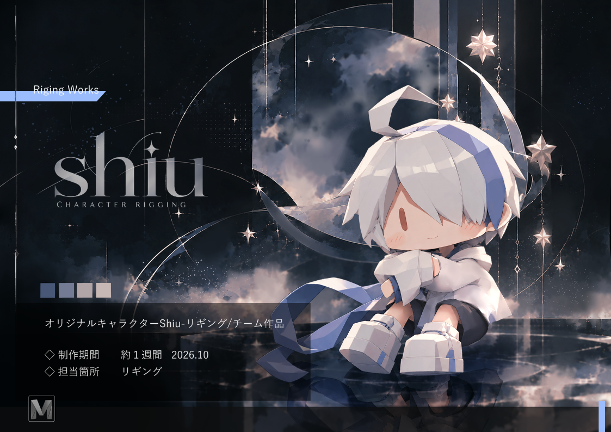

**SDキャラクターリギング | Game Animation Rig**

ゲームアニメーション制作を想定した、SDキャラクター「Shiu（シウ）」のリグです。歩行やジャンプなどの基本動作に対応できる操作系を中心に、丸みのある体幹やフード、アホ毛など、キャラクター固有の表現を組み込みました。

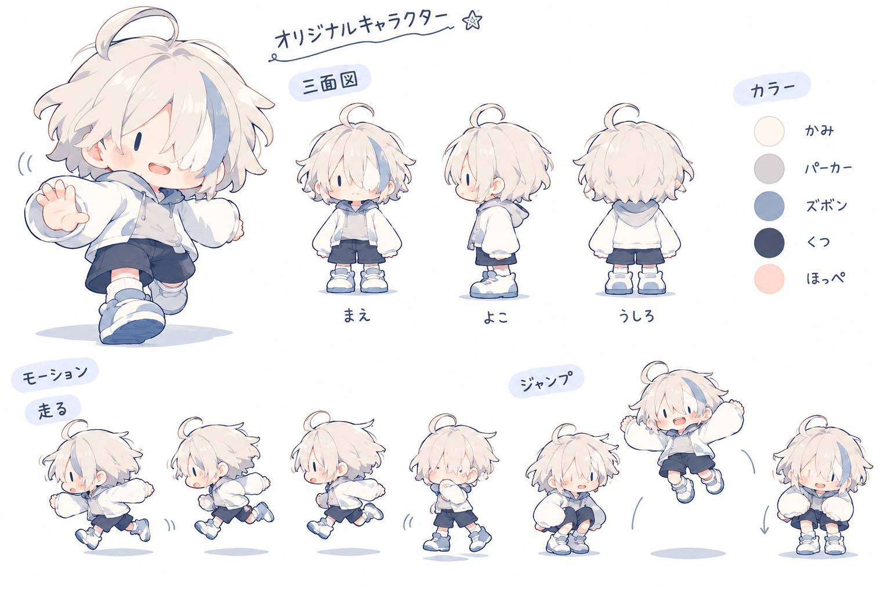
依頼の際にプランナーからいただいたモーション参考資料

**「普段はシンプル、必要なときだけ細かく。」** 通常は主要コントローラーだけで操作し、細かな調整を行いたい場合には追加コントローラーを表示できる設計です。多機能化よりも、操作の分かりやすさと柔らかなシルエットを重視しています。

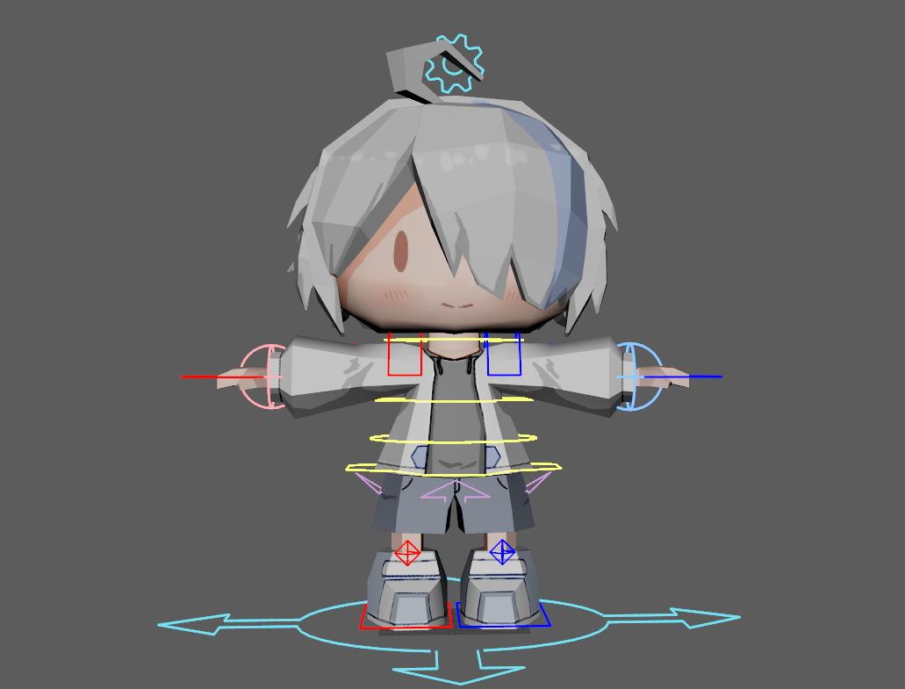

## 目次

- [制作概要](#制作概要)
- [リグ全体・動作デモ](#リグ全体動作デモ)
- [主な機能](#主な機能)
- [技術的な設計と工夫](#技術的な設計と工夫)
- [制作環境・リポジトリ構成](#制作環境リポジトリ構成)
- [使用モデル・公開について](#使用モデル公開について)

## 制作概要

| 項目 | 内容 |
| --- | --- |
| 作品名 | Shiu Character Rig |
| 担当 | リギング / リグシステム設計 
| 使用ソフト | Autodesk Maya 2026 |
| 制作目的 | SDキャラクターのゲームアニメーション・ポージング |
| 使用モデル | Shiu（友人制作のオリジナルモデル） |
| 制作時期 | 2026年10月 |

**設計方針**：
①通常操作を最小限にする ②必要に応じて詳細制御を表示する ③SDキャラクターらしい柔らかな動きを優先する。

## リグ全体・動作デモ

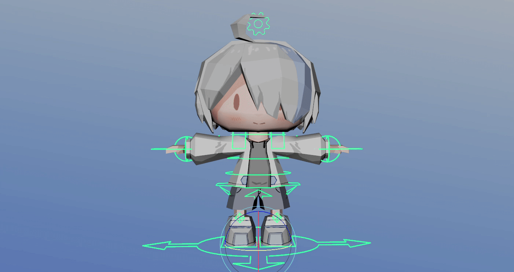

| IK/FK Switching | Flexible Body |
| --- | --- |
| 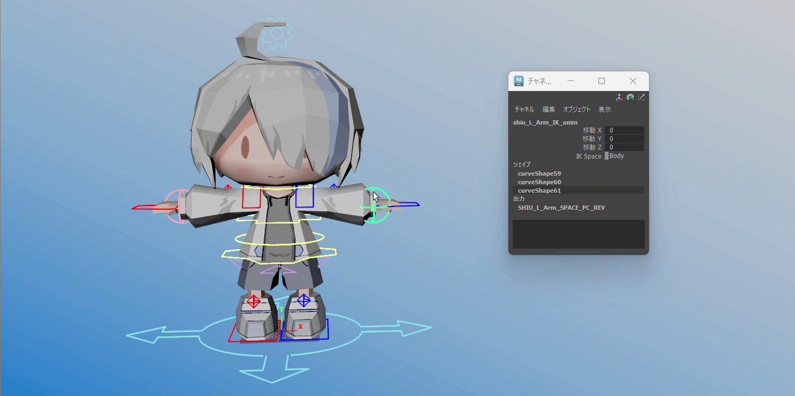 | 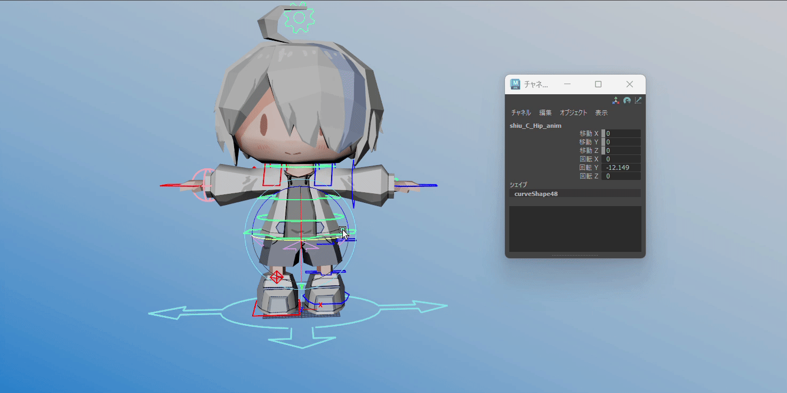 |
| 手足のIK/FK制御 | 丸みを活かす体幹制御 |

| Foot Control | Character-Specific Controls |
| --- | --- |
| 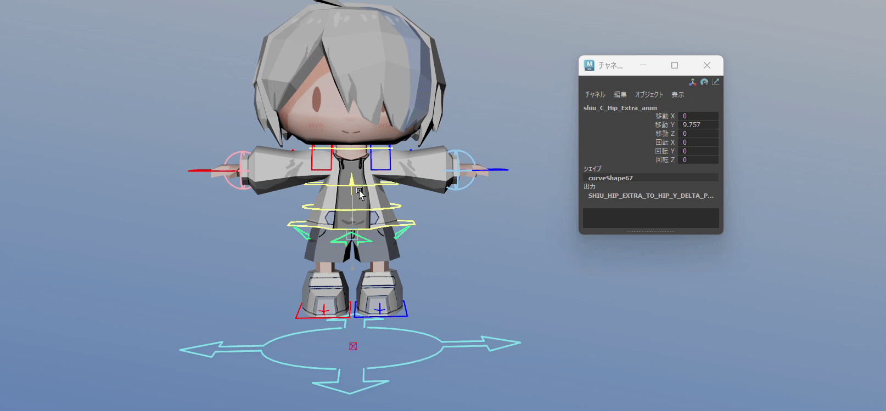 | 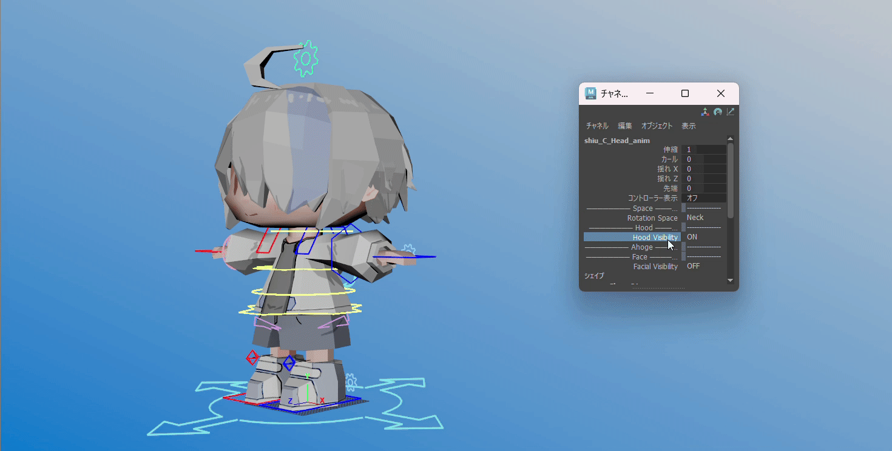 |
| シンプル操作と詳細な接地調整 | フードなどの固有パーツ制御 |


## 主な機能

### 01. 四肢のIK / FK制御


両腕・両脚にIK/FK切替を実装しました。IKでは手足の位置、FKでは関節の回転を中心に操作できます。FK用・IK用のDriverと変形ジョイントを分離し、それぞれの設定コントローラーから制御方式を切り替える構造です。

腕のIKコントローラーには**Body / World**の基準切替を用意し、胴体に追従させる動きと、空間上に手を残したい動きを使い分けられるようにしています。各四肢にはPole Vectorを設け、IK操作時の関節方向を調整できます。

### 02. 二段階の足先制御 | Simple / Reverse


脚の設定コントローラーに**Foot Mode（Simple / Reverse）**を用意しました。通常のポージングではシンプルな足操作を使い、踏み込みやつま先立ちなど接地表現を細かく調整したい場面ではReverse Footを使用できます。

詳細操作では**Foot Roll / Heel Roll / Ball Roll / Toe Roll / Foot Twist**を個別に調整できます。足先の詳細コントローラーは通常時の画面を煩雑にしないよう、必要に応じて使用する構成です。

### 03. IKの追従基準切替

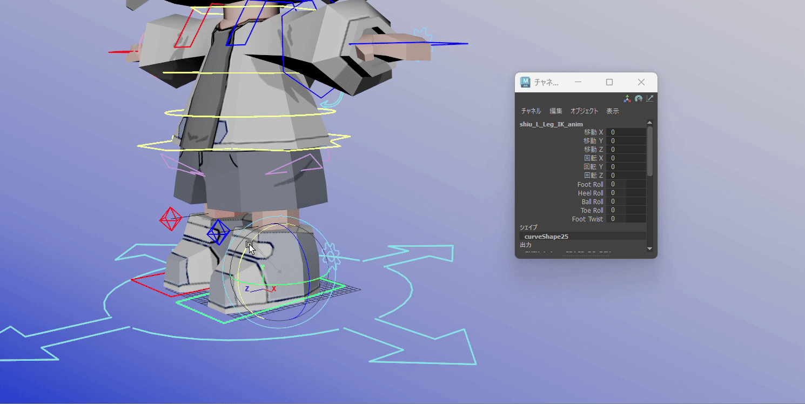

腕・脚のIKに**Body / World**の基準切替を用意しました。脚にはさらに**Hip Follow**を設け、腰の動きとの関係を調整できます。

身体全体を動かすポーズと、手足を空間に留めておきたいポーズの両方を想定し、アニメーションの目的に合わせて操作基準を選べるようにしました。

### 04. 柔らかな体幹制御


**Hip / Abdomen / Spine**を中心に、胴体全体の大きな姿勢と局所的な曲がりを分けて調整できます。Hipの追加コントローラーも備え、必要な場合に細かなポージングを行える構成です。

SDキャラクターの丸みを崩しすぎず、前屈・反り・重心移動などを通じて、柔らかく弾むような印象を作りやすくすることを目指しました。

### 05. 首・頭部の制御 | Neck / World


首と頭部のコントローラーを分け、顔の向きや傾きを独立して調整できます。頭部には**Rotation Space（Neck / World）**を実装しました。

身体の動きに頭を自然に追従させる操作と、頭部の向きを一定の基準に保つ操作を使い分けられます。

### 06. フードとアホ毛の専用制御


フードには専用コントローラーを設け、位置・回転を調整できる構造にしました。頭部の**Hood Visibility**から表示切替も行えます。

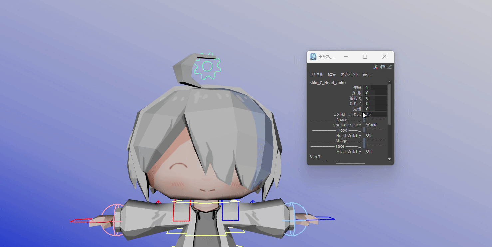

アホ毛には**Root / Mid / Tip**の多段コントローラーを実装。頭部側の属性から**伸縮・カール・X/Z方向の揺れ・先端の調整**を行えるようにしました。詳細コントローラーは必要なときだけ表示できます。

複雑なシミュレーションを前提とせず、キャラクターらしいシルエットやニュアンスを手付けで調整しやすくする設計です。

### 07. フェイシャルと手指の操作


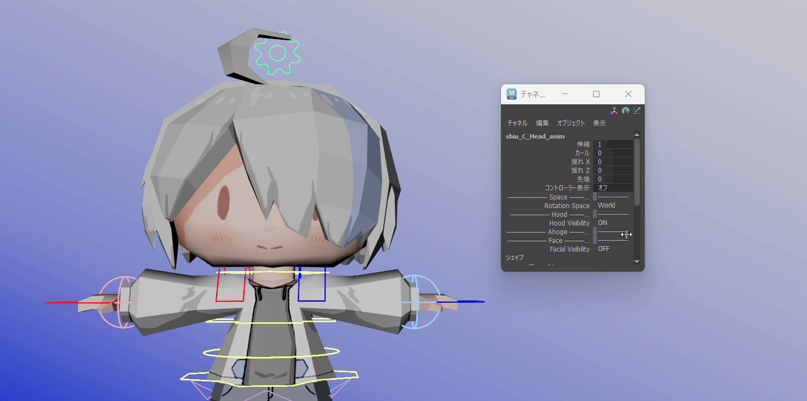

目・眉・口周辺の既存制御を活かし、表情の変化を調整できる構成です。両手の親指には専用のFKコントローラーを備え、腕の設定コントローラーから表示を管理できます。

小さな頭身のキャラクターだからこそ、顔周辺と手先の変化が印象に与える影響を重視しました。

### 08. 必要なときだけ使える詳細コントローラー


補助的な足先操作や親指、アホ毛などの詳細制御は、通常時の画面を見やすくするため、基本操作から切り分けています。アニメーションの場面に応じて表示を切り替えることで、**機能の自由度と視認性を両立**させました。

## 技術的な設計と工夫


操作コントローラー（`*_anim`）、IK/FK用Driver、最終的な変形ジョイントを役割ごとに分離しています。必要な操作だけを表側に出し、切替・追従・補助制御を内部のノード構成で管理する方針です。

| アニメーション上の課題 | 採用した設計 |
| --- | --- |
| コントローラーが多いとSDキャラが見づらい | 主要操作と詳細制御の表示を分離 |
| ポーズによってIK/FKの使い分けが必要 | 四肢のIK/FK制御 |
| 足先の操作を簡単にも細かくも行いたい | Simple / Reverse Foot切替 |
| 胴体を動かしたときに手足の基準を変えたい | Body / World・Hip Follow |
| 丸い胴体の柔らかさを表現したい | Hip / Abdomen / Spineの個別制御 |
| 頭部の方向を維持したい場面がある | Neck / World回転基準切替 |
| キャラクター固有の形状を活かしたい | フードとアホ毛の専用制御 |

### 操作を増やすのではなく、選べるようにする

同じアニメーションでも、必要な調整範囲は場面によって異なります。Shiuではすべてのコントローラーを常時表示するのではなく、通常操作を分かりやすく保ちながら、接地・表情・シルエットなどの詳細調整が必要な場合のみ追加制御を使用できる構成を採用しました。

## 制作環境・リポジトリ構成

- Autodesk Maya 2026
- Python（`maya.cmds`）
- Windows

```text
Shiu-Character-Rig/
├── README.md
└── docs/
    ├── images/
    │   ├── Shiu_Cover.png
    │   ├── Rig_Overview.png
    │   ├── IKFK_Controllers.png
    │   ├── Facial_Controllers.png
    │   └── Rig_Hierarchy.png
    └── gifs/
        ├── Rig_Demo.gif
        ├── IKFK_Switch.gif
        ├── Foot_Control.gif
        ├── IK_Space.gif
        ├── Body_Motion.gif
        ├── Head_Control.gif
        ├── Hood_Control.gif
        ├── Ahoge_Control.gif
        ├── Facial_Demo.gif
        └── Control_Visibility.gif
```

画像・GIFは掲載用の想定ファイル名です。実際にアップロードしたファイル名に合わせてパスを調整してください。

## 使用モデル・公開について

- **Character:** Shiu
- **Original Model:** 友人制作のオリジナルモデル
- **Rigging / Rig System Design:** Yuzuki Midoshima
- **公開予定内容:** リグの動作デモ・画像・技術解説

モデルの著作権は制作者に帰属します。本リポジトリでは、モデルデータおよびMayaリグファイル本体を公開せず、リグの技術解説とデモを掲載する方針です。

---

## Portfolio

[ViViViT](https://vivivit.com/yuzuki_midoshima)

## GitHub

[GitHub - Yuzuki Midoshima](https://github.com/Yuzuki-Midoshima)
